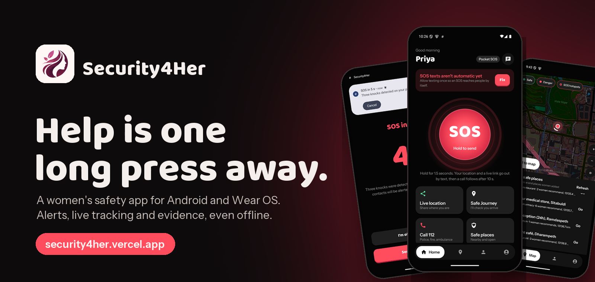
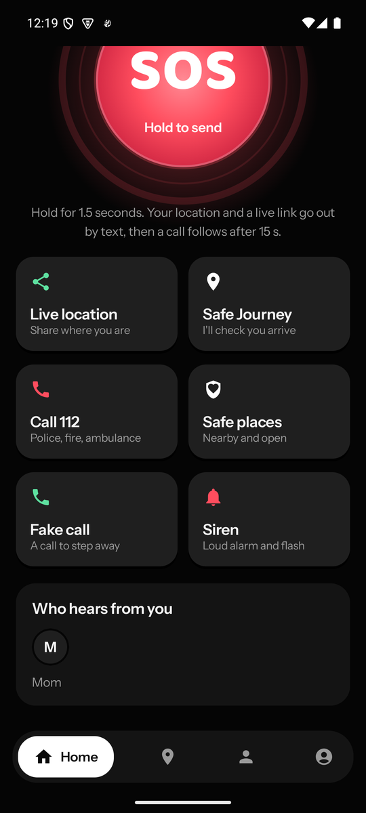
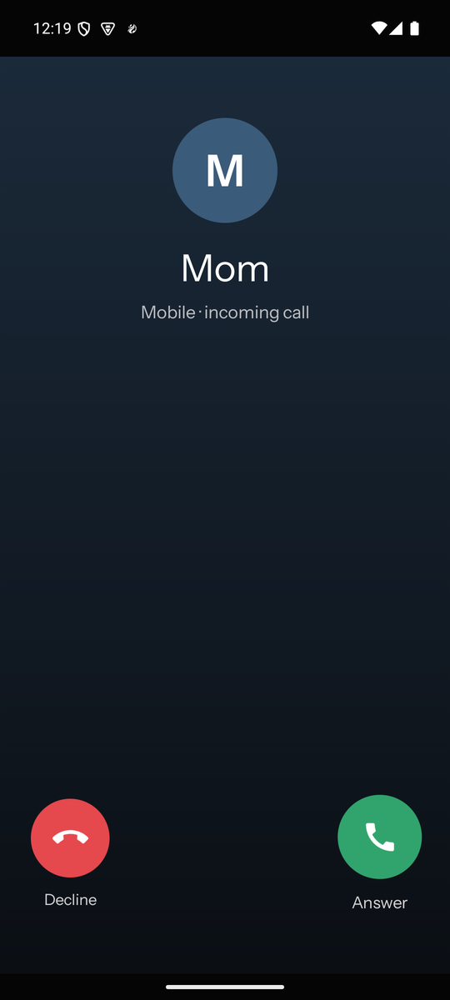
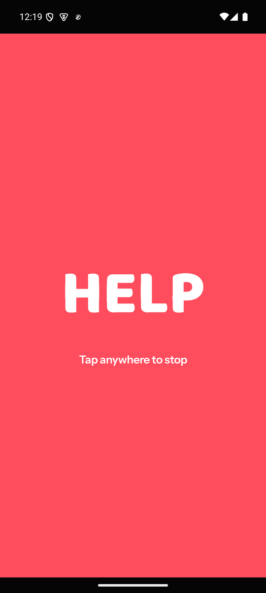
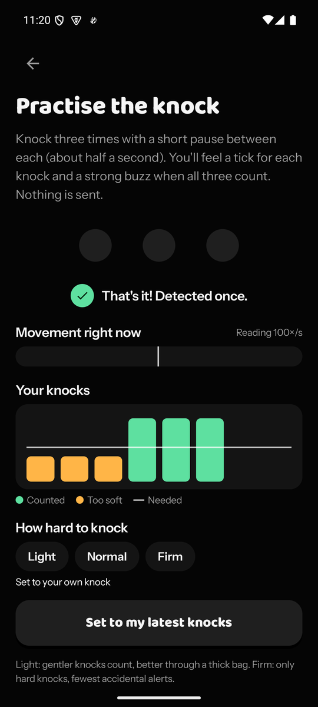
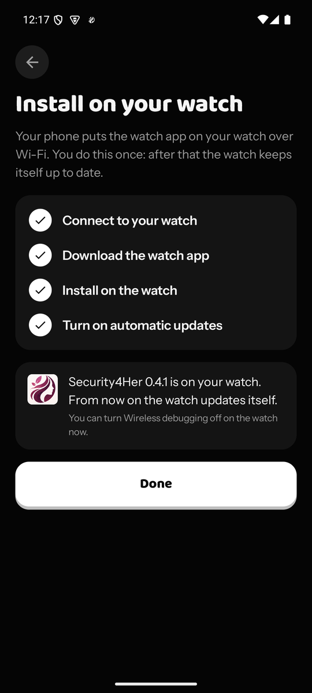
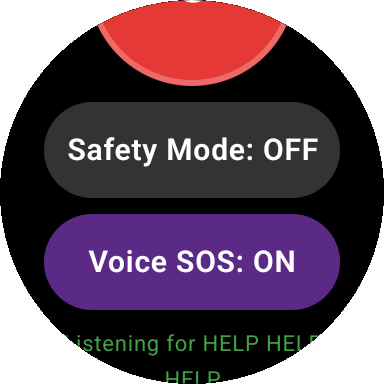
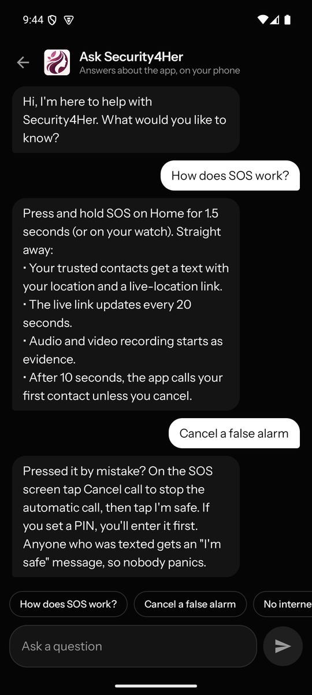
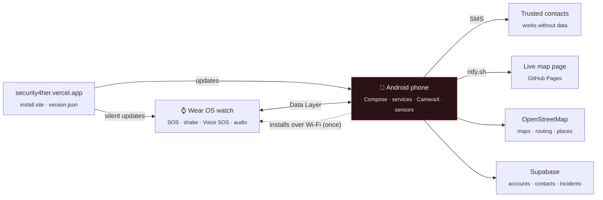

<div align="center">



<br>

[](https://security4her.vercel.app)


**[Features](#features)** &nbsp;•&nbsp; **[Screenshots](#screenshots)** &nbsp;•&nbsp; **[Architecture](#architecture)** &nbsp;•&nbsp; **[Build](#build-from-source)** &nbsp;•&nbsp; **[Privacy](PRIVACY.md)** &nbsp;•&nbsp; **[Changelog](CHANGELOG.md)**

</div>

<br>

## Why

When something goes wrong, safety apps assume she has time: to unlock the phone, find the app and type.
Security4Her turns one action into everything that has to happen next, works without mobile data, and
keeps a record that holds up afterwards.

## Features

<table>
<tr>
<td width="50%" valign="top">

### 🚨 One press, five things happen
- **SMS** to trusted contacts with her location and a live-map link
- **Live map** in any browser, updated every 20 s
- **Audio and video evidence** from the first second
- **Automatic call** after an adjustable countdown
- **Location texts** every 5 min for contacts without data

</td>
<td width="50%" valign="top">

### ✋ Five ways to raise the alarm
- **Hold SOS** for 1.5 s on the home screen
- **Wear OS watch**: button, gesture or shake
- **Voice SOS**: say "HELP HELP HELP" to the watch, recognised on the watch itself
- **Pocket SOS**: knock 3 times through a pocket or bag, screen off
- **Safe Journey**: missed check-ins raise it automatically

</td>
</tr>
<tr>
<td width="50%" valign="top">

### 🗺️ Before it becomes an emergency
- **Fake call**: a realistic incoming call to step away, with a voice on the line
- **Siren**: a loud alarm, even on silent, with a flashing screen and torch
- **Safe Journey** estimates arrival from real routes and checks in if she's late, stopped or off-route
- **Community safety map**: hospitals, police, places women recommend, and red zones from reports and repeated SOS alerts

</td>
<td width="50%" valign="top">

### 🔒 Trust and proof
- **Tamper-evident evidence**: chained SHA-256 fingerprints, 24-hour delete lock, zip export with manifest
- **Women-only**: accounts verified once through DigiLocker
- **Private by default**: location is shared only during an SOS, a journey, or when she chooses ([details](PRIVACY.md))

</td>
</tr>
<tr>
<td colspan="2" valign="top">

### ✨ Looks after itself
Watch installs from the phone in one step, then updates itself silently &nbsp;·&nbsp; protection comes back after a restart &nbsp;·&nbsp; phone updates in-app, fingerprint-checked &nbsp;·&nbsp; knock detection that learns her knock &nbsp;·&nbsp; offline assistant &nbsp;·&nbsp; five colour themes &nbsp;·&nbsp; free to run, no paid APIs

</td>
</tr>
</table>

## Screenshots

<table>
<tr>
<td align="center"><br><sub><b>Home</b><br>Hold SOS</sub></td>
<td align="center"><br><sub><b>Quick actions</b><br>Share, journey, call, deter</sub></td>
<td align="center"><br><sub><b>SOS active</b><br>Timer, evidence, live link</sub></td>
<td align="center"><br><sub><b>Fake call</b><br>A way to step away</sub></td>
</tr>
<tr>
<td align="center"><br><sub><b>Siren</b><br>Loud, flashing, torch strobe</sub></td>
<td align="center"><br><sub><b>Pocket SOS</b><br>Countdown over the lock screen</sub></td>
<td align="center"><br><sub><b>Safety map</b><br>Safe places and red zones</sub></td>
<td align="center"><br><sub><b>Knock tuning</b><br>Learns her knock</sub></td>
</tr>
<tr>
<td align="center"><br><sub><b>Watch install</b><br>From the phone, over Wi-Fi</sub></td>
<td align="center" valign="middle"><br><sub><b>Voice SOS</b><br>One switch on the watch</sub></td>
<td align="center"><br><sub><b>Ask Security4Her</b><br>Offline help</sub></td>
<td align="center" valign="middle"><a href="https://security4her.vercel.app"></a><br><sub><b><a href="https://security4her.vercel.app">Install it</a></b><br>about a minute</sub></td>
</tr>
</table>

## Architecture



No paid APIs: maps and routing come from OpenStreetMap, live location streams through ntfy.sh and Voice SOS
uses the offline [Vosk](https://alphacephei.com/vosk/) recogniser. With no Supabase project configured, the
phone keeps accounts and contacts on the device.

| Path | What |
|---|---|
| [`mobile/`](mobile) | Android phone app (Kotlin, Jetpack Compose) |
| [`wear/`](wear) | Wear OS watch app (Kotlin, Compose for Wear OS) |
| [`web-install/`](web-install) | Install site, `version.json` for updates, `publish.sh` |
| [`web-track/`](web-track) | Server tracking page (used with Supabase) |
| [`supabase/`](supabase) | Postgres migrations, pgTAP tests, Edge Functions |
| [`scripts/`](scripts) | Database test runner, city seed script |
| [`docs/`](docs) | [Device test checklist](docs/TESTING.md), [release guide](docs/RELEASING.md) |
| [`CONTRACT.md`](CONTRACT.md) | Wire format between the watch, phone and server |

## Build from source

**You need** JDK 17 and the Android SDK (API 36). The watch build downloads the 40 MB speech model on its
first run.

```bash
cp local.properties.example local.properties        # set sdk.dir; everything else is optional
./gradlew :mobile:assembleRelease :wear:assembleRelease
adb -s <phone-serial> install -r mobile/build/outputs/apk/release/mobile-release.apk
```

Then install the watch app from the phone: **Me → Install or update the watch app**. With a computer instead:
`adb -s <watch-serial> install -r wear/build/outputs/apk/release/wear-release.apk`.

<details>
<summary><b>First launch</b></summary>

1. Create an account and verify with DigiLocker.
2. Grant the permissions and add a trusted contact.
3. Installs from outside the Play Store need SMS allowed once: **Settings → Apps → Security4Her → ⋮ → Allow
   restricted settings → Permissions → SMS → Allow**. The Home screen walks you through it.
4. Optional: **Me → Pocket SOS**, then *Practise and adjust strength* to teach it your knock.
5. Optional, on the watch: turn on **Voice SOS** from its home screen and try **Practise**.

</details>

<details>
<summary><b>Signing</b></summary>

Both apps use the package name `in.security4her.app` and are signed with the key in `keystore/`. Wear OS only
lets the phone and watch apps talk when both match, and updates only install over a build signed with the
same key. See [Signing](docs/RELEASING.md#signing) for moving to a private key without a reinstall.

</details>

## Testing

| What | Command |
|---|---|
| Phone unit tests (knock detection and more) | `./gradlew :mobile:testDebugUnitTest` |
| Watch unit tests (Voice SOS phrase logic, shake logic, wire format) | `./gradlew :wear:testDebugUnitTest` |
| Lint, both apps | `./gradlew :mobile:lintDebug :wear:lintDebug` |
| Database schema, RLS and RPCs (pgTAP) | `scripts/test_db.sh` |
| Edge Functions | `node --experimental-strip-types --test supabase/functions/tests/functions.test.ts` |

CI runs the unit tests and lint and builds both release APKs on every push ([`android.yml`](.github/workflows/android.yml)).
Before a release, run the [device test checklist](docs/TESTING.md).

## Releasing

Bump `versionCode` and `versionName`, then run one command. Phones offer the update on their next launch;
watches install it by themselves.

```bash
bash web-install/publish.sh "What's new, in one sentence"
```

See [`docs/RELEASING.md`](docs/RELEASING.md).

## Known limitations

- Android doesn't let apps dial **112** automatically: the countdown calls her chosen number and shows a one-tap *Call 112*.
- **SMS needs the phone's SIM.** Without the phone, the watch can only reach the server over Wi-Fi.
- **Installs from outside the Play Store** need SMS allowed once, and the watch needs Wireless debugging once for the first install.
- After the watch restarts, Android only lets **Voice SOS** use the microphone again after one tap on its notification.
- **Voice SOS** was tuned on recorded voices in street noise; words run together very fast ("helphelphelp") can be missed.
- **Battery life** over a full day with Voice SOS on has not been measured.
- **Community reports** are user-submitted, not official crime data.

## Team

**OBSIDIAN**
