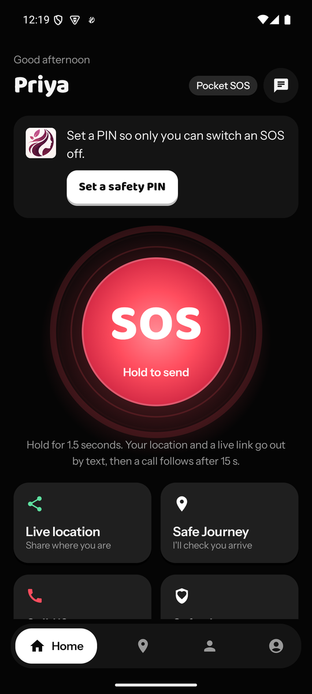
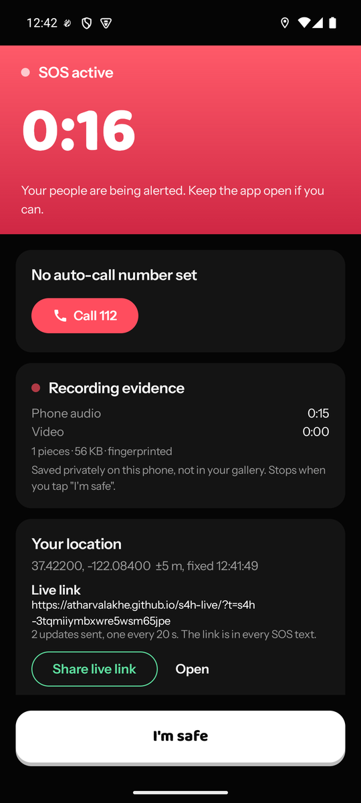
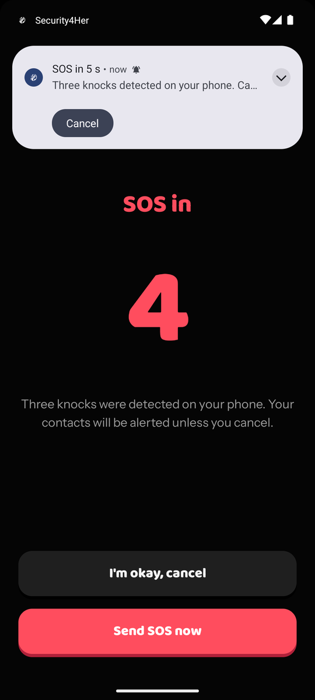
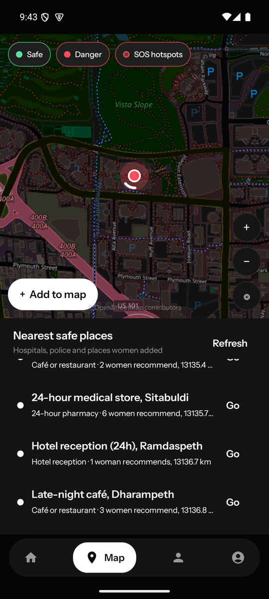

<p align="center">
  
</p>

<h1 align="center">Security4Her</h1>

<p align="center">
  <b>Help is one long press away.</b><br>
  A women's safety app for Android and Wear OS that alerts, tracks and records the moment she needs it, even without internet.
</p>

<p align="center">
  <a href="https://security4her.vercel.app"><b>Install</b></a> ·
  <a href="#features">Features</a> ·
  <a href="#architecture">Architecture</a> ·
  <a href="#building">Building</a> ·
  <a href="docs/RELEASING.md">Releasing</a> ·
  <a href="docs/DEMO.md">Demo script</a>
</p>

<p align="center">
  
  
  
  
</p>

> **Hackathon project, not an emergency service.** It has not been certified or tested at scale.
> Keep **Test Mode** on while trying it: texts and calls meant for the police go to your own demo number.

---

## Features

**Raising the alarm**
- **Hold SOS** for 1.5 seconds on the home screen; a filling ring prevents accidental presses.
- **From the watch** (Wear OS): SOS button, a configured gesture, or shaking the wrist in Safety Mode.
- **Pocket SOS**: knock three times on the phone through a pocket or bag, screen off. It learns each user's knock, vibrates when armed and counts down 5 seconds so a false alarm can be cancelled.
- **Safe Journey**: pick a destination; if she is late, stops too long or goes the wrong way and doesn't answer a check-in, an SOS goes out by itself.

**When an SOS starts**
- SMS to trusted contacts with her location and a live-map link (works without mobile data).
- A live map, updated every 20 seconds, that anyone can open in a browser.
- Audio and video evidence recording from the first second; the watch records audio too.
- An automatic call to a chosen number after an adjustable countdown (3–60 s).
- A fresh location text every 5 minutes for contacts without internet.

**Around it**
- **Community safety map**: hospitals, police and places women recommend; red zones from reports and repeated SOS alerts.
- **Tamper-evident evidence**: every recording piece gets a chained SHA-256 fingerprint, is kept out of the gallery, is locked from deletion for 24 hours and exports as one zip with a manifest.
- **Women-only community**: accounts are verified once through DigiLocker (demo sign-in in this build).
- **Ask Security4Her**: an offline in-app assistant for "how does this work?" questions.
- **In-app updates** for phone and watch, fingerprint-checked before install.
- Five colour themes, all keeping SOS red as the one loud colour.

## Architecture

```
 Wear OS watch ──Data Layer──► Android phone ──► SMS network        alerts with no data
 (SOS, shake,   (messages +    (Compose UI,  ──► ntfy.sh stream ──► live map page (GitHub Pages)
  audio)         file channel)  services,    ──► OpenStreetMap      maps, routing, places
                                CameraX)     ──► Supabase           accounts, contacts, incidents
                                                                    (local demo mode when unset)
```

No paid APIs: maps and routing come from OpenStreetMap, live location streams through ntfy.sh, and the
phone runs in a self-contained demo mode when no Supabase project is configured.

## Repository layout

| Path | What |
|---|---|
| [`mobile/`](mobile) | Android phone app (Kotlin, Jetpack Compose) |
| [`wear/`](wear) | Wear OS watch app (Kotlin, Compose for Wear OS) |
| [`web-install/`](web-install) | Install website, `version.json` for in-app updates, `publish.sh` |
| [`web-track/`](web-track) | Live-location page linked from SOS texts |
| [`supabase/`](supabase) | Postgres migrations, pgTAP tests, Edge Functions |
| [`scripts/`](scripts) | Database test runner, city seed script |
| [`docs/`](docs) | Demo script, release guide, integration contract, archived plans |
| [`keystore/`](keystore) | The shared **debug** keystore, so phone and watch builds can talk |

## Building

**Requirements:** JDK 17, Android SDK 36, a phone on Android 8+ and optionally a Wear OS 3+ watch.

```bash
cp local.properties.example local.properties   # set sdk.dir; Supabase keys are optional
./gradlew :mobile:assembleDebug :wear:assembleDebug
adb -s <phone-serial> install -r mobile/build/outputs/apk/debug/mobile-debug.apk
adb -s <watch-serial> install -r wear/build/outputs/apk/debug/wear-debug.apk
```

Both apps share one package name and signing key; the watch and phone can only talk to each other when
they match. Leaving `SUPABASE_URL` empty runs the phone in demo mode with accounts and contacts stored
on the device.

**On first launch:** create an account, verify with the demo DigiLocker account (Aadhaar `2345 6789 4821`,
OTP `123456`), grant permissions, add a trusted contact and set a demo number in Test Mode.

**Sideloaded installs** need SMS allowed once: Settings → Apps → Security4Her → ⋮ → *Allow restricted
settings* → Permissions → SMS → Allow. The app walks through this on the Home screen.

## Testing

| What | Command |
|---|---|
| Phone unit tests (knock detector and more) | `./gradlew :mobile:testDebugUnitTest` |
| Watch unit tests (shake logic, wire format) | `./gradlew :wear:testDebugUnitTest` |
| Lint, both apps | `./gradlew :mobile:lintDebug :wear:lintDebug` |
| Database schema, RLS and RPCs (pgTAP) | `scripts/test_db.sh` |
| Edge Functions | `node --experimental-strip-types --test supabase/functions/tests/functions.test.ts` |

CI runs the Android builds, unit tests and lint on every push ([`android.yml`](.github/workflows/android.yml)).
A manual device checklist is in [`docs/DEMO.md`](docs/DEMO.md).

## Releasing

Bump `versionCode`/`versionName` in `mobile/build.gradle.kts` and/or `wear/build.gradle.kts`, then:

```bash
bash web-install/publish.sh "What's new, in one sentence"
```

This builds both apps, publishes them with `version.json` to the install site, and installed apps offer
the update on their next launch. Details: [`docs/RELEASING.md`](docs/RELEASING.md).

## Known limitations

- **Android does not let apps dial 112 automatically.** The countdown calls the configured number and shows a one-tap *Call 112*.
- **SMS needs the phone's SIM.** Without the phone, the watch can only reach the server over Wi-Fi.
- **Sideloaded apps** need SMS allowed once (above); a Play Store release removes this step.
- **DigiLocker, the assistant and Supabase** run as local demos unless credentials are configured.
- **Battery life, Doze behaviour and long-running reliability** have not been measured.
- **Community reports** are user-submitted, not official crime data.

## Docs

- [`docs/DEMO.md`](docs/DEMO.md): the 5-minute demo script and device test matrix.
- [`docs/RELEASING.md`](docs/RELEASING.md): publishing a new version.
- [`CONTRACT.md`](CONTRACT.md): package, versions, Data Layer paths, RPCs and SMS format.
- [`docs/archive/`](docs/archive): the original hackathon plans.

## Team

[Team name]: [member names]. Built at [Hackathon name].
